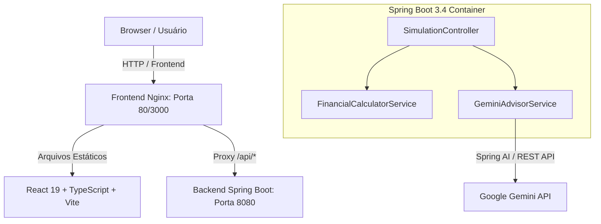

# Arquitetura do Sistema: Calculadora CDB vs À Vista

Este documento descreve a arquitetura técnica, o fluxo de dados, a modelagem de entidades e as fórmulas financeiras utilizadas no simulador.

---

## 1. Diagrama de Arquitetura



---

## 2. Fluxo de Dados e Endpoints

### 2.1 `POST /api/simulation/calculate`
Calcula o fluxo determinístico da compra e a tabela mês a mês.

- **Request Body (`SimulationRequest`)**:
```json
{
  "valorTotal": 1200.00,
  "descontoAVistaPercentual": 5.0,
  "quantidadeParcelas": 10,
  "comJuros": false,
  "taxaJurosParcelamento": 0.0,
  "percentualCdi": 105.0,
  "taxaCdiAnual": 11.25,
  "considerarIrRegressivo": true
}
```

- **Response Body (`SimulationResult`)**:
Retorna o veredito (`melhorOpcao`), valores calculados, custo efetivo, economia em R$ e a lista `mesesEvolucao` com o decaimento mês a mês.

### 2.2 `POST /api/simulation/ai-analysis`
Invoca a inteligência do Gemini para avaliar o ponto de equilíbrio (*break-even*) e dar parecer estratégico.

---

## 3. Fórmulas e Regras de Negócio

### 3.1 Taxa Mensal Efetiva
$$i_{\text{ano}} = \frac{\text{taxaCdiAnual}}{100} \times \frac{\text{percentualCdi}}{100}$$
$$i_{\text{mes}} = (1 + i_{\text{ano}})^{\frac{1}{12}} - 1$$

### 3.2 Tabela Regressiva de Imposto de Renda (IR)
Conforme a legislação brasileira para aplicações de renda fixa (CDB):
- **Até 180 dias** (1º ao 6º mês): 22,5%
- **De 181 a 360 dias** (7º ao 12º mês): 20,0%
- **De 361 a 720 dias** (13º ao 24º mês): 17,5%
- **Acima de 720 dias** (> 24º mês): 15,0%

### 3.3 Ponto de Equilíbrio (Break-Even Discount)
$$\text{Desconto de Equilíbrio (\%)} = \frac{\text{Rendimento Líquido Total} + (\text{Total Parcelado} - \text{Valor Original})}{\text{Valor Total}} \times 100$$
Se o desconto à vista oferecido pela loja for **maior** que o ponto de equilíbrio, **pagar à vista** preserva mais capital. Se for **menor**, manter investido e **parcelar** é financeiramente superior.
